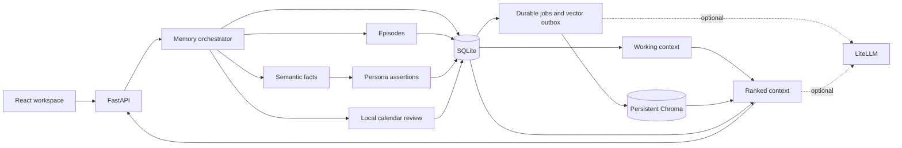

# Studyfolio

Studyfolio is the local web interface for the **Learner Memory & Persona Intelligence System**. A conversation can produce a remembered learning episode, an evidence-linked preference, or an academic deadline to review. Every extracted assertion links to its source turn. The workspace opens empty.

## Install on Windows

Open **Settings → Data sources** to upload a survey JSON, academic transcript, curriculum template or academic notice. Review imported fields before confirming them. Chat answers link back to source pages or JSON fields. The upgrade audit includes the verified retrieval trace, service configuration and limitations. [Multi-source implementation audit](docs/multi_source_audit.md)

Use Python 3.12, Node.js 22.12+ or 24, and npm. Run these PowerShell commands in the selected project directory. The base install supports offline chat, memory, search, and calendar operations.

```powershell
Set-Location "$env:USERPROFILE\OneDrive\Desktop\adobe-persona-calendar"
python --version
node --version
python -m venv .venv
.\.venv\Scripts\python.exe -m pip install -e "./backend[dev]"
if (!(Test-Path .env)) { Copy-Item .env.example .env }
Push-Location frontend
npm.cmd ci
npm.cmd run build
Pop-Location
.\.venv\Scripts\python.exe -m app.cli migrate
.\.venv\Scripts\python.exe -m app.cli serve
```

The server prints its local address at startup. This verified workspace opens on [port 8010](http://127.0.0.1:8010), with the [API reference on the same port](http://127.0.0.1:8010/docs). A fresh copy of `.env.example` defaults to [port 8000](http://127.0.0.1:8000). The backend serves the compiled React app and handles direct links to its pages. Stop the server with Ctrl+C. The included `scripts\start.ps1` runs the same server using the project's virtual environment.

For frontend development, keep the backend running and use a second PowerShell window.

```powershell
Set-Location "$env:USERPROFILE\OneDrive\Desktop\adobe-persona-calendar\frontend"
npm.cmd run dev
```

Open the [Vite development interface](http://127.0.0.1:5173). Its `/api` proxy reads `APP_PORT` from the project environment and defaults to loopback port 8000.

## Use the workspace

1. In **Study chat**, start a conversation. Try “I prefer short explanations,” then “Actually, I now prefer detailed explanations.” Click a source on a reply to revisit its original turn. The conversation menu supports renaming, closing, reopening, reprocessing, and deletion.
2. In **Memory Explorer**, inspect recent turns, episodes, semantic facts, and persona assertions. Search each layer or run **Inspect retrieval** to see ranked context, source IDs, budget consumption, and exclusions.
3. In **Learner Persona**, add a field, correct a value, inspect its revisions, or confirm or reject an inference. **Reflect on recent conversations** queues a local job. Manual edits have a traceable “Profile edits” conversation.
4. Say “My mechanics assignment is due on November 18, 2030.” In **Local Calendar**, review the suggestion. After confirmation, say “That assignment deadline moved to November 20, 2030.” Confirm the reschedule to see both dates in the event history. Month, agenda, upcoming, and overdue views use the configured timezone.
5. In **Settings**, configure the working window, timezone, reflection interval and calendar policy. Review job failures, rebuild the index, export JSON or ICS, or erase local data.

## Four memory layers

| Layer | Stored representation | How it is used |
| --- | --- | --- |
| Working | A time-, count-, and token-bounded view over persisted turns in one conversation | Supplies recent equations, topics, and open discussion. Older excerpts are available on request. |
| Episodic | Significant learning interactions with time bounds, topic, type, summary, and evidence | Answers historical questions using dated self-reports. Related turns can share an episode. |
| Semantic | Normalized subject, predicate, value, scope, validity, evidence, and status | Consolidates durable facts and preserves earlier values on correction. |
| Persona | Field-level assertions with evidence, decision status, linked semantic facts, and revision history | Supplies relevant learning preferences and a structured learner profile. |



The backend uses Python, FastAPI, Uvicorn, SQLAlchemy, Alembic, SQLite FTS5, Pydantic, dateutil, zoneinfo, tzdata and icalendar. The frontend uses React, TypeScript, React Router, TanStack Query, Vite, Lucide, locally bundled fonts, and ordinary CSS. Chroma and sentence-transformers add local semantic search. LiteLLM supplies the optional generation interface.

## Storage and configuration

Default data on Windows lives in `%LOCALAPPDATA%\Studyfolio`, outside the OneDrive project. SQLite uses `sqlite\learner_memory.db` and the persistent vector index uses `chroma\`. `APP_DATA_DIR` overrides the base directory. `DATABASE_URL` and `CHROMA_PERSIST_DIR` can override individual stores. Downloads contain the JSON or ICS exports. `.env.example` documents startup configuration. User-editable defaults are copied into SQLite on first use. Change existing workspace preferences from Settings.

The application supports one local learner and one backend process. It binds to `127.0.0.1`, restricts browser origins, and keeps credentials server-side. Stored content uses ordinary local files and inherits the user's OS protections. JSON and ICS downloads are independent copies. The interactive UI provides notifications while it is open.

## Optional local embeddings and LLM

```powershell
.\.venv\Scripts\python.exe -m pip install -e "./backend[vectors]"
.\.venv\Scripts\python.exe -m app.cli cache-model
```

Model caching explicitly downloads the selected model. Normal indexing opens cached weights with `local_files_only=True`. The first load can take time. Missing packages or weights leave SQLite lexical search available. Check Settings for index status and use **Rebuild index** after installing weights. Set `VECTOR_ENABLED=false` for a lexical-only installation.

To enable generation, install the optional provider dependency and edit the local `.env` file.

```powershell
.\.venv\Scripts\python.exe -m pip install -e "./backend[ai]"
```

Set `LLM_ENABLED=true` and set `LLM_MODEL` to the exact LiteLLM provider/model identifier available to your account. Supply that provider's credential through its environment variable, such as `GEMINI_API_KEY` or `OPENAI_API_KEY`. Restart the server. **Enabling a remote model sends selected conversation text, source context, and relevant calendar facts to the configured provider.** Calendar storage, queries, confirmation, editing, and export all run locally.

Without a provider, extraction recognizes a defined set of English academic statements, search returns saved evidence, and chat can list confirmed dates. Open-ended tutoring, paraphrase understanding, and free-form reflection depend on the selected model.

## Synthetic demonstration

```powershell
.\.venv\Scripts\python.exe -m app.cli demo
.\.venv\Scripts\python.exe -m app.cli serve --demo
```

The command seeds six clearly labeled conversations in a separate `synthetic-demo` database, using fixed source times. Rerunning it preserves the same conversation and request identities. It includes a corrected preference, difficulty with rotational dynamics, a recalled preference, and one confirmed mechanics deadline rescheduled from November 18 to November 20, 2026. Run the ordinary server to return to the personal workspace. The demo and personal servers use the same configured port, so stop the first server before switching.

## Verification

```powershell
Push-Location backend
..\.venv\Scripts\python.exe -m pytest -q
..\.venv\Scripts\python.exe -m ruff check .
..\.venv\Scripts\python.exe -m ruff format --check .
Pop-Location
Push-Location frontend
npm.cmd run typecheck
npm.cmd test
npm.cmd run build
Pop-Location
```

To exercise the real cached encoder and Chroma persistence, install the vector extra and cache its weights, then set `$env:TEST_LOCAL_VECTORS='1'`. To test the installed LiteLLM transport, install the AI extra and set `$env:TEST_LOCAL_LITELLM='1'`. Then run the same pytest command. The base suite skips these two optional integrations. Tests use temporary stores, deterministic fixtures and a loopback HTTP endpoint. No provider account or key is needed.

To run the real browser workflow after building the frontend:

```powershell
.\.venv\Scripts\python.exe -m pip install playwright
.\.venv\Scripts\python.exe -m playwright install chromium
.\.venv\Scripts\python.exe scripts\browser_smoke.py
```

## Troubleshooting

| Symptom | Check |
| --- | --- |
| Backend starts but the root URL returns 404 | Build the frontend, then restart the backend so it mounts `frontend/dist`. |
| npm is blocked by PowerShell execution policy | Use `npm.cmd` as in the setup commands. |
| Port 8000 is unavailable | Set `APP_PORT` in `.env` to an available port, then restart the backend and Vite. |
| Vector status indicates lexical fallback | Check optional packages and cached weights, then run **Rebuild index**. The SQL database remains authoritative. |
| An extraction job failed | Check the model identifier, provider credentials, and connectivity. Use **Retry** in Settings. Existing messages remain accessible. |
| A date is uncertain or a correction matches several assignments | Open the suggestion, choose the intended event and resolve the local date and time. |
| An earlier fact appears in history | Inspect its status, validity interval, revision, and original source. Current retrieval filters historical values. |

See the [engineering report](docs/engineering_report.md), [architecture](docs/architecture.md), [memory policies](docs/memory_design.md), [calendar rules](docs/calendar_design.md), [API examples](docs/api.md), and [reference attribution](docs/reference_attribution.md).
