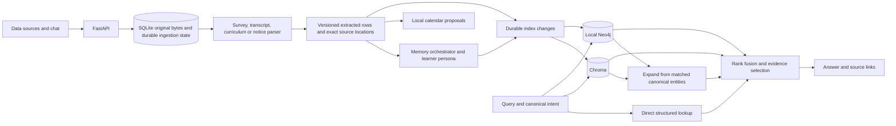

# Multi-source ingestion and retrieval audit

Verified on Windows, November 10, 2026. The current workspace runs on [port 8010](http://127.0.0.1:8010/settings/sources), with the [development frontend](http://127.0.0.1:5173/settings/sources) using the same API.

## Inputs and preservation

A recursive search including ignored and hidden project files found none of `student_profile(1).json`, `download(1).pdf`, or `ME-template(1).pdf`. No extraction result in this report comes from those three files. The parser and browser checks used generated survey and PDF fixtures. To verify another file, open **Settings → Data sources**, upload it, inspect the page or JSON-pointer evidence, and explicitly confirm the appropriate survey fields.

Git reported an uncommitted `main` working tree. A commit-to-commit diff of the interrupted run was unavailable. The review followed the existing models, migrations, orchestrator, persona and evidence code, provider, vector store, calendar service, routes, React pages, upload flow, fixtures and verification scripts. Existing endpoint names and five-screen navigation were retained.

SQLite’s online backup API produced a private, integrity-checked backup under the workspace database’s `sqlite/backups` directory. Migration 0004 adds source documents, source items, durable graph work and index-change triggers. Migration 0005 stores a pending reclassification separately from the last successfully parsed source type. Earlier migrations remain available.

The live store advanced from 0003 to 0005. Before and after migration, complete ordered-row digests matched for all nine checked tables.

| Existing table | Rows preserved |
| --- | ---: |
| Conversations | 7 |
| Messages | 33 |
| Calendar events | 3 |
| Calendar candidates | 3 |
| Calendar event revisions | 3 |
| Memories | 9 |
| Memory evidence | 9 |
| Persona revisions | 3 |
| User settings | 1 |

The migrated database returned `ok` from `PRAGMA integrity_check` and zero rows from `PRAGMA foreign_key_check`. The live workspace was checked read-only after startup. Synthetic acceptance data was confined to disposable databases.

## Implementation



| Requirement | Implementation and evidence |
| --- | --- |
| Local upload and source lifecycle | The 16 MiB upload limit, SHA-256 deduplication and private SQLite BLOB storage preserve original bytes. Source state survives restart. Parsing runs on a separate worker. All derived rows of a successful revision commit together. Failed sources show a warning and a retry control. |
| Survey import and completion | Structured leaves retain their original JSON pointer, datatype, selection meaning and provenance. Imported values start in review. The editor lets the learner select individual fields, add missing information and confirm revisions. Synthetic values stay outside retrieval until specifically confirmed. Skills remain self-reports. False career-option checkboxes produce no negative or positive goal assertion. |
| Transcript extraction | PyMuPDF extracts page text and ruled tables. The parser recognizes labeled identity/performance fields, semester/session context, course code, title, grade and credits. It preserves printed codes and row evidence. In the two-page fixture, MTH112M had grade A and 6 credits on page 1. ME209 had grade B and 8 credits on page 2. The unavailable current-courses section produced an explicit unknown state. [PyMuPDF page API](https://pymupdf.readthedocs.io/en/latest/page.html) |
| Curriculum reference | Semester cells retain column context in recognized ruled tables. BT, BTH, BTM, dual-degree, double-major and minor fixtures were queried independently. Planned courses and requirements are programme records. Prerequisite and equivalency edges link printed course identifiers. Suffixes remain significant. |
| Memory and calendar | Imports have closed source journals, linked evidence turns and an import episode. Eligible facts use the existing semantic and persona engines. Ordinary chat continues to use working and episodic context. Confirmed manual corrections supersede previous values. Calendar notices create local proposals with page provenance. Curriculum semesters generate no calendar events. |
| Semantic retrieval | The existing cached sentence-transformer indexes semantic memories and episodes. A persistent `document_chunks` collection holds field-, row- and passage-level embeddings. Local indexing batches embeddings and verifies the SQL record before committing a vector change. Record deletion removes associated vectors. |
| Independent graph traversal | Parameterized queries read a private, workspace-scoped graph. `SFEntity` nodes carry canonical keys. `SF_REL` edges carry a validated relationship kind and record/evidence IDs. `SF_META` edges connect assertions, messages, conversations, documents, terms and course attempts. The driver accepts loopback Bolt only. SQLite stores pending changes and supplies bounded graph traversal when Neo4j is unavailable. [Neo4j driver transactions](https://neo4j.com/docs/python-manual/current/transactions/) |
| Query and response | Deterministic aliases map college, institute, university and enrollment questions to `ENROLLED_AT`. Optional LiteLLM refinement can propose a validated relation for an unrecognized intent. Direct lookup, semantic search, independent graph lookup and neighbor expansion feed RRF. Evidence selection checks current SQL status, source authority, programme, course and term. Equivalent facts retain independent citations. Ambiguity can produce clarification or abstention. Questions and assistant replies are excluded as primary evidence for personal facts. [RRF method](https://plg.uwaterloo.ca/~gvcormac/cormacksigir09-rrf.pdf) |
| Debugging and repair | Memory Explorer exposes a multi-source trace with original and normalized query, filters, path hits, fusion scores, chosen evidence, answer and service states. Data sources shows projected graph counts, pending work, source conflicts, original download and revisions. Settings supports vector repair. The source screen supports graph reindexing. |

Core code lives in `backend/app/source_models.py`, `source_parse.py`, `sources.py`, `source_api.py`, `source_inference.py`, `knowledge.py` and `cdf.py`. Existing memory, vector, calendar and API modules supply their original responsibilities. `frontend/src/DataSources.tsx` provides document review and the trace panel. `backend/tests/test_sources.py`, `scripts/source_browser_smoke.py` and `scripts/verify_graph.py` exercise the upgrade.

## Recorded college/institution trace

This trace was emitted by the real Chroma and Neo4j integration script. The evidence was a confirmed survey field at `/institution` and a generated academic transcript on page 1. Both source records refer to the same institution. In this run the two evidence IDs were `92c03c0a-202f-4b37-9b13-5c47cffae31e` (A) and `7025a235-0910-4db0-8c9a-b01b31bb87c2` (B).

| Trace field | Observed value |
| --- | --- |
| Query | In which college I study? |
| Normalized semantic query | In which college I study? enrolled at |
| Intent and canonical relation | `identity_lookup`, `Learner → ENROLLED_AT → IIT Kanpur` |
| Direct structured lookup | A, B |
| Real Chroma semantic hits | A, B |
| Independent Neo4j path | B, A |
| Semantic-guided Neo4j expansion | B, A |
| Fused ranks | B and A each scored `0.06504494976203068` with `k=60` |
| Selected result | One canonical fact, two independent source citations |
| Answer | **You study at IIT Kanpur.** |

The script also asked “In which institution do I study?” and asserted the same answer and identical direct-evidence set. Other tests exercised different wording, unrelated institutions, conflicting sources, and absence of evidence. RRF scores rank items and do not measure the probability a fact is true.

## Verification and service status

- Pre-upgrade baseline: **45 backend tests and 7 React tests passed**.
- Full upgraded backend suite with `TEST_LOCAL_VECTORS=1`, `TEST_LOCAL_LITELLM=1` and local weights: **57 passed, 0 failed, 0 skipped**, in 89.43 seconds. Seven third-party deprecation warnings were reported.
- Frontend: **9 component tests passed**, including unselected synthetic survey fields and failed-source retry controls. Strict TypeScript checking and the Vite production build passed.
- Real Neo4j Community 5.26.0 ran in a disposable, password-protected local Java 21 process. The test wrote evidence-backed edges, executed traversal, fused results with real Chroma hits, removed the source documents, and verified zero remaining primary edges in that workspace. The fixture process was stopped.
- Chroma tests verified the physical document collection, IDs, semantic retrieval, graph expansion, reopening a new application instance, and removal of deleted-source vectors. The live app reported `vector_status=ready` and `mode=offline`.
- The personal workspace has no configured Neo4j credential. Its live graph status reports SQLite fallback and queues graph updates. Its existing local Bolt listener was left untouched. Hosted LLM credentials were not used.
- Chromium exercised the three upload types, selective survey confirmation, programme filtering, college/CPI/courses/template/goals answers, source-link navigation, restart and a manual institution correction. The original chat, persona, calendar rescheduling, settings, mobile navigation and process-restart smoke test also passed.

## Windows PowerShell

The installed production app serves the compiled frontend. To restart it after stopping the current instance:

```powershell
Set-Location "$env:USERPROFILE\OneDrive\Desktop\adobe-persona-calendar"
.\.venv\Scripts\python.exe -m app.cli serve
```

For a fresh installation or to update dependencies:

```powershell
Set-Location "$env:USERPROFILE\OneDrive\Desktop\adobe-persona-calendar"
if (!(Test-Path .\.venv\Scripts\python.exe)) { python -m venv .venv }
.\.venv\Scripts\python.exe -m pip install -e "./backend[dev,ai,vectors]"
if (!(Test-Path .env)) { Copy-Item .env.example .env }
$env:APP_PORT = '8010'
Push-Location frontend
npm.cmd ci
npm.cmd run build
Pop-Location
.\.venv\Scripts\python.exe -m app.cli migrate
.\.venv\Scripts\python.exe -m app.cli serve
```

The base dependency set (`./backend[dev]`) supports PDF/JSON ingestion and deterministic retrieval. Cache the optional encoder once with `.\.venv\Scripts\python.exe -m app.cli cache-model`. For Vite development, run `$env:APP_PORT='8010'` and `npm.cmd run dev` in a second PowerShell window inside `frontend`.

To enable a local Neo4j instance, set `NEO4J_URI=bolt://127.0.0.1:7687`, `NEO4J_USER` and `NEO4J_PASSWORD` in the ignored local environment, restart Studyfolio, then use **Data sources → Reindex graph**. The account needs read/write permission on its local database. The application never initializes or changes that account’s password. For reproducible integration testing with a separate unpacked Community distribution, run:

```powershell
.\.venv\Scripts\python.exe scripts\verify_graph.py 'C:\path\to\java.exe' 'C:\path\to\neo4j-community-5.26.0' --vectors
```

To rerun the application checks:

```powershell
$env:HF_HUB_OFFLINE='1'
$env:TEST_LOCAL_VECTORS='1'
$env:TEST_LOCAL_LITELLM='1'
Push-Location backend
..\.venv\Scripts\python.exe -m pytest -q
..\.venv\Scripts\python.exe -m ruff check .
Pop-Location
Push-Location frontend
npm.cmd test
npm.cmd run typecheck
npm.cmd run build
Pop-Location
.\.venv\Scripts\python.exe -m pip install playwright
.\.venv\Scripts\python.exe -m playwright install chromium
.\.venv\Scripts\python.exe scripts\browser_smoke.py
.\.venv\Scripts\python.exe scripts\source_browser_smoke.py --vectors
```

## Partial coverage and remaining limitations

- **Real-file extraction accuracy remains unverified.** Supply the named files through Data sources to inspect their actual layouts, grade conventions, and provenance declarations. Fixture grades, credits and institution names describe synthetic records only.
- Deterministic parsers handle recognized English headings, structured course rows and semester grids. Unrecognized multi-column arrangements and ambiguous rows require review. The original page text is retained. Sparse pages can use local OCR when `SOURCE_OCR=true` and suitable Tesseract language data is installed. Successful OCR of the learner’s documents was not tested.
- Survey provenance conventions vary. Ambiguous mixed-provenance exports remain unverified until field-by-field confirmation. A user-confirmed transcript correction or skill answer is not independent assessment evidence.
- The graph is an active educational evidence projection. The authoritative calendar and full historical supersession trail remain in SQLite. The inspector returns a live query trace. There is no permanent trace archive or arbitrary Cypher interface.
- Extraction and indexing are eventually consistent. The UI exposes pending or failed work. The system has not been load-tested on a large document corpus. The SQLite evidence projection and lexical fallback currently inspect the local candidate set in memory.
- Live hosted-provider quality was not measured. Local ingestion works without a key. When explicitly enabling `SOURCE_LLM_ENABLED=true` with a configured LLM, selected narrative page excerpts can be transmitted to that provider. Narrative triples require exact quote grounding and review.
